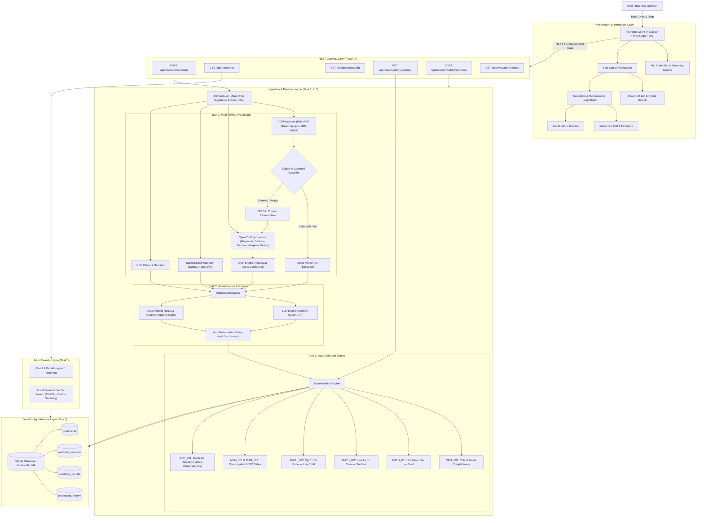
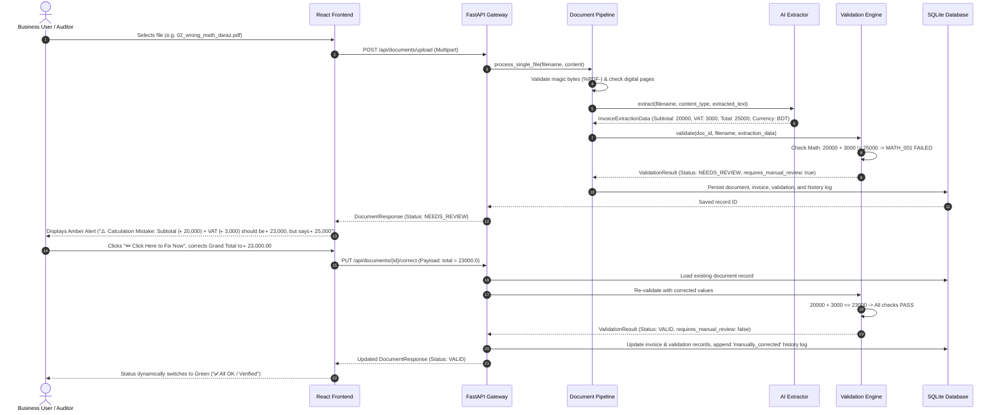

# System Architecture & Database Schema Specification
### DocuIntellect • AI-Powered Document Intelligence & Verification System

This document specifies the technical architecture, data processing flow, entity-relationship models, and storage schemas for the DocuIntellect enterprise platform.

---

## 🏛️ End-to-End System Architecture

---

## 🔄 Interaction Sequence Diagram: Ingestion, Validation & Human Correction (BDT ৳)

---

## 🗄️ Relational Database Entity-Relationship Diagram (ERD)

```mermaid
erDiagram
    DOCUMENT_RECORD ||--o| EXTRACTED_INVOICE_RECORD : "contains"
    DOCUMENT_RECORD ||--o| VALIDATION_RESULT_RECORD : "evaluated_by"
    DOCUMENT_RECORD ||--o{ PROCESSING_HISTORY_RECORD : "tracks"

    DOCUMENT_RECORD {
        string id PK "Unique UUID (64 chars)"
        string filename "Original file name"
        string file_type "MIME type"
        int file_size "Size in bytes"
        string content_hash "SHA-256 hash"
        string status "queued | processing | processed | failed"
        string raw_file_path "Path to saved raw bytes on disk"
        int page_count "Total pages in document"
        text sheet_names_json "JSON array of workbook sheet names"
        float processing_time_ms "Processing latency in milliseconds"
        string extraction_method "digital_pdf | ocr | hybrid_pdf | spreadsheet"
        string error_code "Null or error code"
        text error_reason "Structured error reason if failed"
        datetime created_at "Record creation timestamp"
        datetime updated_at "Record last update timestamp"
    }

    EXTRACTED_INVOICE_RECORD {
        int id PK "Autoincrement primary key"
        string document_id FK "Foreign key to documents.id (CASCADE)"
        string invoice_number "Invoice reference number"
        string invoice_date "Standardized ISO 8601 date (YYYY-MM-DD)"
        string supplier_name "Vendor / Supplier entity name"
        string customer_name "Client / Customer entity name"
        string currency "ISO currency code (e.g. USD, EUR)"
        float subtotal "Net amount before tax"
        float tax "Computed or recorded tax amount"
        float total "Grand invoice total amount"
        text line_items_json "JSON array of itemized line objects"
        float extraction_confidence "Score from 0.0 to 1.0"
        string extraction_engine "gemini | openai | deterministic | human_corrected"
        text uncertain_fields_json "JSON array of low-confidence fields"
        text missing_fields_json "JSON array of omitted fields (Null policy)"
        text raw_text_summary "Consolidated document text summary"
        text pages_json "JSON array of page-level extraction records"
        text sheets_json "JSON dictionary of sheet-level data"
    }

    VALIDATION_RESULT_RECORD {
        int id PK "Autoincrement primary key"
        string document_id FK "Foreign key to documents.id (CASCADE)"
        string validation_status "valid | needs_review | invalid"
        boolean requires_manual_review "True if any rule failed"
        float confidence_score "Aggregated validation confidence score"
        text rule_results_json "JSON array of ValidationRuleResult objects"
        text duplicate_info_json "JSON object with matched duplicate details"
        int errors_count "Count of failed validation rules"
        int warnings_count "Count of warning validation rules"
        int passed_count "Count of passed validation rules"
    }

    PROCESSING_HISTORY_RECORD {
        int id PK "Autoincrement primary key"
        string document_id FK "Foreign key to documents.id (CASCADE)"
        string action "uploaded | processed | manually_corrected | reprocessed | failed"
        text details "Human-readable description of change"
        datetime timestamp "UTC timestamp of event"
    }
```

---

## 📋 Table Definitions & Indexing Strategy

### 1. Table: `documents`
Stores core document identity, physical file attributes, processing state, and error isolation logs.

| Column | Type | Constraints | Description |
| :--- | :--- | :--- | :--- |
| `id` | `VARCHAR(64)` | `PRIMARY KEY`, `INDEX` | Unique identifier (UUIDv4) |
| `filename` | `VARCHAR(255)` | `NOT NULL` | Original uploaded filename |
| `file_type` | `VARCHAR(100)` | `NOT NULL` | Detected MIME content type |
| `file_size` | `INTEGER` | `NOT NULL`, `DEFAULT 0` | File length in bytes |
| `content_hash` | `VARCHAR(64)` | `INDEX`, `NULLABLE` | SHA-256 hash of raw file bytes |
| `status` | `VARCHAR(32)` | `INDEX`, `NOT NULL` | `queued`, `processing`, `processed`, `failed` |
| `raw_file_path` | `VARCHAR(512)` | `NULLABLE` | Local filesystem path to stored bytes |
| `page_count` | `INTEGER` | `DEFAULT 0` | Number of document pages |
| `sheet_names_json`| `TEXT` | `DEFAULT '[]'` | JSON array of sheet names |
| `processing_time_ms`| `FLOAT` | `DEFAULT 0.0` | End-to-end processing latency |
| `extraction_method`| `VARCHAR(64)`| `DEFAULT 'none'` | `digital_pdf`, `ocr`, `spreadsheet_parser` |
| `error_code` | `VARCHAR(64)` | `NULLABLE` | Structured error code (e.g. `CORRUPTED_HEADER`) |
| `error_reason` | `TEXT` | `NULLABLE` | Detailed error explanation |
| `created_at` | `DATETIME` | `DEFAULT CURRENT_TIMESTAMP` | Initial upload timestamp |
| `updated_at` | `DATETIME` | `DEFAULT CURRENT_TIMESTAMP` | Last modification timestamp |

### 2. Table: `extracted_invoices`
Stores structured financial fields extracted by the AI Information Extraction engine (Task 2) or human operators.

| Column | Type | Constraints | Description |
| :--- | :--- | :--- | :--- |
| `id` | `INTEGER` | `PRIMARY KEY`, `AUTOINCREMENT` | Record ID |
| `document_id` | `VARCHAR(64)` | `FOREIGN KEY (documents.id)`, `UNIQUE`, `INDEX` | Parent document link |
| `invoice_number` | `VARCHAR(128)` | `INDEX`, `NULLABLE` | Extracted invoice reference number |
| `invoice_date` | `VARCHAR(32)` | `INDEX`, `NULLABLE` | ISO 8601 formatted date string |
| `supplier_name` | `VARCHAR(255)` | `INDEX`, `NULLABLE` | Extracted vendor entity name |
| `customer_name` | `VARCHAR(255)` | `INDEX`, `NULLABLE` | Extracted recipient entity name |
| `currency` | `VARCHAR(16)` | `DEFAULT 'USD'` | Currency symbol or ISO code |
| `subtotal` | `FLOAT` | `NULLABLE` | Net financial amount |
| `tax` | `FLOAT` | `NULLABLE` | Tax / VAT / GST amount |
| `total` | `FLOAT` | `NULLABLE` | Grand total payable |
| `line_items_json` | `TEXT` | `DEFAULT '[]'` | Serialized array of `{description, quantity, unit_price, line_total}` |
| `extraction_confidence` | `FLOAT` | `DEFAULT 0.0` | Model confidence score (0.0 to 1.0) |
| `extraction_engine` | `VARCHAR(64)` | `DEFAULT 'deterministic'` | `gemini`, `openai`, `deterministic_regex`, `human_corrected` |
| `uncertain_fields_json`| `TEXT` | `DEFAULT '[]'` | Fields flagged with low confidence |
| `missing_fields_json` | `TEXT` | `DEFAULT '[]'` | Fields not detected in source file |
| `raw_text_summary` | `TEXT` | `NULLABLE` | Preprocessed text content |
| `pages_json` | `TEXT` | `DEFAULT '[]'` | Structured page content array |
| `sheets_json` | `TEXT` | `DEFAULT '{}'` | Structured sheet content dictionary |

### 3. Table: `validation_results`
Stores the automated findings and verification flags generated by the Task 3 Data Validation Engine.

| Column | Type | Constraints | Description |
| :--- | :--- | :--- | :--- |
| `id` | `INTEGER` | `PRIMARY KEY`, `AUTOINCREMENT` | Record ID |
| `document_id` | `VARCHAR(64)` | `FOREIGN KEY (documents.id)`, `UNIQUE`, `INDEX` | Parent document link |
| `validation_status` | `VARCHAR(32)` | `INDEX`, `DEFAULT 'valid'` | `valid`, `needs_review`, `invalid` |
| `requires_manual_review`| `BOOLEAN` | `DEFAULT FALSE` | Flag indicating user action required |
| `confidence_score` | `FLOAT` | `DEFAULT 0.0` | Aggregated verification score |
| `rule_results_json` | `TEXT` | `DEFAULT '[]'` | List of individual rule results |
| `duplicate_info_json` | `TEXT` | `NULLABLE` | Metadata of duplicate match if detected |
| `errors_count` | `INTEGER` | `DEFAULT 0` | Total failed validation rules |
| `warnings_count` | `INTEGER` | `DEFAULT 0` | Total warning validation rules |
| `passed_count` | `INTEGER` | `DEFAULT 0` | Total passed validation rules |

### 4. Table: `processing_history`
Append-only audit trail logging all lifecycle actions on a document.

| Column | Type | Constraints | Description |
| :--- | :--- | :--- | :--- |
| `id` | `INTEGER` | `PRIMARY KEY`, `AUTOINCREMENT` | History log ID |
| `document_id` | `VARCHAR(64)` | `FOREIGN KEY (documents.id)`, `INDEX` | Parent document link |
| `action` | `VARCHAR(64)` | `NOT NULL` | `uploaded`, `processed`, `manually_corrected`, `reprocessed`, `failed` |
| `details` | `TEXT` | `NOT NULL` | Description of action taken and rule updates |
| `timestamp` | `DATETIME` | `DEFAULT CURRENT_TIMESTAMP` | Action timestamp (UTC) |

---

## 🔎 Hybrid Search Index Architecture (Task 5)

The search layer implements dual query resolution:
1. **Keyword Search:** Executed via SQLite SQL queries with case-insensitive `LIKE` matching on `documents.filename`, `extracted_invoices.invoice_number`, `extracted_invoices.supplier_name`, and `extracted_invoices.customer_name`.
2. **Local Semantic Vector Search:**
   - Vectorizer: `scikit-learn` `TfidfVectorizer(stop_words='english', ngram_range=(1, 2), lowercase=True)`
   - Corpus: Built dynamically from composite document text tokens (filename, supplier, line item descriptions, raw text summary).
   - Similarity Metric: Cosine similarity between query vector and corpus matrix:
     $$\text{Similarity}(q, d) = \frac{\mathbf{q} \cdot \mathbf{d}}{\|\mathbf{q}\| \|\mathbf{d}\|}$$
   - Relevance Boost: Exact substring occurrences receive an automatic relevance weight boost ($+0.15$), and scores are normalized between $0\%$ and $100\%$.
