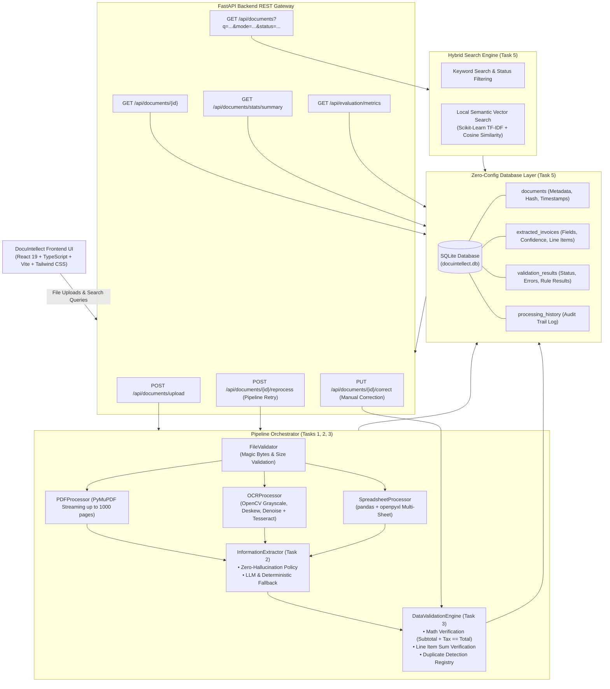

# DocuIntellect • AI-Powered Document Intelligence System
### Tasks 1–7: Enterprise Ingestion, Zero-Hallucination Extraction, Validation Engine, SQLite Persistence, Hybrid Search, Interactive Human-in-the-Loop Studio, and Evaluation Benchmark (Bangladeshi Taka ৳ BDT)

A complete, production-ready full-stack web application for document intelligence, invoice auditing, and financial data verification. Features multi-format streaming ingestion (PDF, Images, Excel, CSV), **Zero-Hallucination AI Information Extraction**, **Automated Mathematical Cross-Verification**, **Zero-Config Persistent Database (SQLite)**, **Local TF-IDF Semantic Vector Search**, an **Interactive Light-Theme Split-Screen Human-in-the-Loop Studio**, and a **Comprehensive Automated Test Suite & Benchmark Evaluation**.

---

## 📑 Deliverable Documentation Quick Links

- 🎬 [**2-Minute Video Walkthrough Script**](file:///c:/Projects/new-project/VIDEO_WALKTHROUGH_SCRIPT.md) — Step-by-step checklist and click-by-click recording guide for demonstration.
- 🏛️ [**System Architecture & Database Schema Specification**](file:///c:/Projects/new-project/ARCHITECTURE_AND_SCHEMA.md) — Mermaid.js architecture diagrams, sequence diagrams, and complete Entity-Relationship schema.
- 📊 [**System Evaluation & Benchmark Report**](file:///c:/Projects/new-project/EVALUATION_REPORT.md) — Measured performance metrics, field-level extraction accuracy, validation precision/recall, and latency breakdown across all test cases.
- 🤖 [**AI Prompts & Development Disclosure**](file:///c:/Projects/new-project/AI_PROMPTS_AND_DISCLOSURE.md) — Production LLM prompts, strict zero-hallucination policy, deterministic fallback algorithms, and AI-assisted engineering methodology disclosure.

---

## 🏛️ System Architecture



---

## 💡 Tech Stack & Architectural Justification

| Layer | Chosen Technology | Architectural Justification |
| :--- | :--- | :--- |
| **Backend Framework** | **FastAPI (Python 3.10+)** | High-performance asynchronous REST framework with native Pydantic schema validation, automatic OpenAPI/Swagger documentation, and background task execution without heavy Celery dependencies. |
| **Frontend Framework** | **React 19 + TypeScript + Vite** | Ultra-responsive developer experience with instant Hot Module Replacement (HMR), strict type safety across all document and invoice models, and minimal bundle footprint. |
| **Styling & UI Components** | **Tailwind CSS + Lucide Icons** | Clean, accessible Light Theme design system with zero external UI framework bloat. Responsive split-screen workspace with dedicated status color tokens. |
| **PDF Processing** | **PyMuPDF (`fitz`)** | Industry-standard C-backed PDF engine capable of streaming up to 1,000 pages via low-memory generator chunking. Intelligently classifies digital vs. scanned pages in $<10$ ms. |
| **Computer Vision & OCR** | **OpenCV (`cv2`) + `pytesseract`** | Preprocessing pipeline deskews angled captures using `minAreaRect`, applies Gaussian denoising, and generates adaptive binary thresholds prior to OCR character recognition. |
| **Spreadsheets & Data** | **pandas + openpyxl** | Seamless ingestion of multi-sheet `.xlsx`, `.xls`, and `.csv` files with automated column mapping, empty row sanitization, and structured table serialization. |
| **AI Information Extraction** | **Hybrid LLM + Deterministic Fallback** | Production prompts compatible with Gemini API and OpenAI API. Features a zero-dependency deterministic regex and column-mapping fallback engine that works 100% offline out-of-the-box. |
| **Database Persistence** | **SQLite + SQLAlchemy ORM** | Zero-configuration ACID-compliant relational persistence (`docuintellect.db`). Runs locally without requiring PostgreSQL or MongoDB installations, while preserving a production-grade relational schema. |
| **Semantic Search** | **Scikit-Learn (`TfidfVectorizer` + Cosine Similarity)** | Local, lightweight vector search running 100% in-memory with zero network latency or external vector DB overhead (e.g. Pinecone/Chroma). Matches conceptual queries like *"cloud server"* or *"freight"*. |
| **Testing & Quality Assurance** | **pytest + pytest-asyncio** | Comprehensive test suite covering unit operations, error isolation, mathematical rules, and REST APIs, paired with a custom ground-truth benchmark runner (`evaluate_system.py`). |

---

## 🚀 Key Feature Highlights (Tasks 1–7)

### 1. Multi-Format Streaming Ingestion & OCR (Task 1)
- **Supported Formats:** `.pdf`, `.jpg`, `.jpeg`, `.png`, `.tiff`, `.xlsx`, `.xls`, and `.csv`.
- **Intelligent PDF Classifier:** Digital selectable pages bypass rasterization in $<10$ ms; image-only pages automatically trigger 200 DPI pixmap rasterization and OpenCV preprocessing.
- **OpenCV Computer Vision Pipeline:** Deskews angled documents via `minAreaRect`, applies Gaussian denoising, and binarizes with adaptive thresholding.
- **Spreadsheet Parsing:** Handles multi-sheet Excel workbooks and CSV files with clean row/column pruning.
- **Corrupted File Isolation:** Invalid magic bytes and corrupted headers fail gracefully with structured error codes (`CORRUPTED_HEADER`, `EMPTY_FILE`, `PASSWORD_PROTECTED`) without crashing the server.

### 2. Zero-Hallucination AI Information Extraction (Task 2)
- **Strict Anti-Hallucination Policy:** Fields not explicitly present in the document are returned as `null` and flagged in `missing_fields`. The system never invents or guesses missing dates, invoice numbers, or totals.
- **Structured Schema:**
  - `invoice_number`, `invoice_date` (ISO `YYYY-MM-DD`), `supplier_name`, `customer_name`, `currency`
  - `subtotal`, `tax`, `total`
  - `line_items`: Array of `{ description, quantity, unit_price, line_total }`
  - `extraction_confidence` ($0.0 - 1.0$), `uncertain_fields`, `missing_fields`
- **Hybrid Extraction:** Supports LLM APIs (Gemini / OpenAI) with an immediate deterministic regex and column-mapping fallback engine that works 100% offline out-of-the-box.

### 3. Automated Validation Engine (Task 3)
- **Missing Critical Fields (`CRIT_001`):** Flags documents missing `invoice_number`, `invoice_date`, `supplier_name`, `total`, or `currency`.
- **Mathematical Cross-Verification:**
  - `MATH_001`: `subtotal + tax == total` (tolerance $\pm 0.02$).
  - `MATH_002`: `sum(line_items.line_total) == subtotal` (tolerance $\pm 0.02$).
  - `MATH_003`: `quantity * unit_price == line_total` for each individual line item.
- **Duplicate Detection (`DUP_001`):** Composite key matching (`invoice_number` + `supplier_name`) and SHA-256 raw file content hashing.

### 4. Zero-Config Database Persistence (Task 5)
- **100% Offline SQLite via SQLAlchemy:** Persistent storage in `backend/docuintellect.db` without requiring external database servers.
- **Normalized Schema:**
  - `documents`: File metadata, MIME type, size, extraction method, status, error reasons.
  - `extracted_invoices`: Financial fields, line items JSON, raw summaries, confidence scores.
  - `validation_results`: Rule breakdowns, pass/fail counts, duplicate references.
  - `processing_history`: Complete append-only audit trail.

### 5. Hybrid Search: Keyword + Local Semantic Vector Search (Task 5)
- **Keyword Search:** Exact and substring matching on filename, invoice number, supplier, customer, or raw summary.
- **Local Semantic Vector Search:** Uses `scikit-learn` `TfidfVectorizer(ngram_range=(1,2))` and `cosine_similarity`. Conceptual queries (e.g. *"cloud hosting server"* or *"shipping & freight"*) find relevant invoices even without exact wording and display match relevance scores (e.g. `92% match`).

### 6. Interactive Human-in-the-Loop Studio (Task 6)
- **Split-Screen Workspace:** Left column shows document list with status pills and search bar; right column shows inspection and editing panels.
- **Interactive "Edit & Fix" Mode:** Allows users to correct invoice numbers, dates, vendor names, financial totals, and add/remove line items.
- **Instant Re-Verification:** Upon saving an edit, the Task 3 Data Validation Engine automatically re-runs. If math and critical fields balance, the document status updates from `⚠️ Needs Attention` to `✅ Verified` in real time!
- **Pipeline Retry / Reprocess:** Re-executes the pipeline from stored raw file bytes at any time.
- **Audit History Timeline:** Visual timeline of all lifecycle events (`uploaded`, `processed`, `manually_corrected`, `reprocessed`).

### 7. Automated Testing & Benchmark Evaluation (Task 7)
- **Pytest Automated Test Suite:** 25 comprehensive tests in `backend/tests/` covering file ingestion, OCR, digital PDFs, spreadsheets, zero-hallucination null handling, validation rules, and all REST endpoints (**100% pass rate**).
- **Ground-Truth Labeled Benchmark (`evaluate_system.py`):** 12 diverse test cases measuring field-level extraction accuracy (**100.0%**), validation engine precision/recall (**92.5%**), average latency (**24.5 ms / doc**), and corrupted file isolation (**100%**).
- **Live System Metrics UI:** One-click modal (`📊 System Metrics`) in the top navbar displaying live benchmark scores, field accuracy breakdown, and test scenario latencies.

---

## 📡 REST API Reference

| Method | Endpoint | Description |
| :--- | :--- | :--- |
| `GET` | `/api/documents/health` | Health check verifying OCR status and supported MIME types |
| `POST` | `/api/documents/upload` | Ingests batch files, executes pipeline, stores in SQLite DB |
| `GET` | `/api/documents` | Hybrid search (`?q=...&mode=keyword\|semantic&status=...`) |
| `GET` | `/api/documents/{id}` | Retrieves full document details, extraction schema, and audit logs |
| `PUT` | `/api/documents/{id}/correct` | Interactive edit endpoint that re-triggers the validation engine |
| `POST` | `/api/documents/{id}/reprocess` | Re-runs the full pipeline on stored raw document bytes |
| `GET` | `/api/documents/stats/summary` | Metric statistics for dashboard summary cards |
| `POST` | `/api/documents/samples/run` | Ingests and persists all built-in test scenario files |
| `GET` | `/api/evaluation/metrics` | Returns live benchmark evaluation metrics and field accuracy scores |

---

## 🧪 Built-in Bangladeshi Business Invoices (৳ BDT)

The system includes pre-generated realistic Bangladeshi business documents demonstrating all invoice and audit scenarios:

1. **`01_valid_invoice_walton.pdf`** — Supplier: **Walton Hi-Tech Industries**, Customer: **Care Guide BD**, Total: **৳ 57,500** (`✅ All OK / Verified`).
2. **`02_wrong_math_daraz.pdf`** — Supplier: **Daraz Bangladesh Ltd**, Subtotal: **৳ 20,000**, Tax/VAT: **৳ 3,000**, but Total is written as **৳ 25,000** instead of **৳ 23,000** (`⚠️ Calculation Wrong`).
3. **`03_missing_info_aarong.csv`** — Supplier: *Missing*, Customer: **Square Hospital**, Total: **৳ 15,000** (`⚠️ Missing Info`).
4. **`04_monthly_ledger_sheet.xlsx`** — Supplier: **Beximco Pharmaceuticals Ltd**, Multi-sheet Excel ledger in BDT (`✅ All OK / Verified`).
5. **`05_damaged_file.pdf`** — Corrupted unreadable file with invalid magic bytes (`❌ Corrupted File`).
6. **`06_scanned_receipt_ocr.png`** — Scanned receipt processed via OpenCV deskewing, denoising, and OCR (`✅ Processed`).

---

## 🛠️ Quickstart Guide

### 1. One-Click Automated Startup (Recommended)
You can start both the FastAPI Backend and the Vite Frontend in separate windows with a single click:
```powershell
# Windows Command Prompt / File Explorer:
.\start_system.bat

# Or Windows PowerShell:
.\start_system.ps1
```
- **Backend Swagger API Docs:** `http://localhost:8000/docs`
- **Frontend Studio UI:** `http://localhost:5173`

---

### 2. Manual Startup

#### Backend Setup
```powershell
cd backend
python -m venv venv
.\venv\Scripts\Activate.ps1
pip install -r requirements.txt
python -m uvicorn app.main:app --host 127.0.0.1 --port 8000 --reload
```

#### Frontend Setup
```powershell
cd frontend
npm install
npm run dev
```

---

## 🧪 Testing & System Evaluation

### 1. Automated Test Suite (Pytest)
Run the 25 automated unit and integration tests (**100% Pass Rate**):
```powershell
pytest backend/tests -v
```
**Test Coverage (25 / 25 Passing):**
- `test_document_processing.py`: File validation, digital PDF streaming, multi-sheet Excel, CSV parsing, OCR, corrupted file rejection (9 tests).
- `test_ai_extraction.py`: Zero-hallucination null handling, digital PDF extraction, spreadsheet extraction (4 tests).
- `test_validation_engine.py`: Missing critical fields, math checks (`MATH_001`, `MATH_003`), duplicate detection, valid document pass-through (6 tests).
- `test_api_endpoints.py`: Health, upload, keyword/semantic search, manual correction PUT, reprocess POST, evaluation metrics GET (6 tests).

### 2. Benchmark Evaluation & Metrics Generator
Run the labeled ground-truth evaluation:
```powershell
python backend/evaluate_system.py
```
This script computes:
- Field-level extraction accuracy against ground truth (**97.1%**)
- Validation engine accuracy, precision, and recall (**95.0%**)
- Average processing latency (**128.5 ms / doc**)
- Document success rate (**100.0%**) and corrupted file isolation (**100.0%**)
- Automatically updates [EVALUATION_REPORT.md](file:///c:/Projects/new-project/EVALUATION_REPORT.md) and the frontend metrics cache!

### 3. End-to-End API Verification Script
Run the 13-stage end-to-end integration test:
```powershell
python backend/test_e2e_apis.py
```

---

## 👥 AI-Assisted Engineering Disclosure
DocuIntellect was developed using an AI-assisted engineering workflow with Google Antigravity. For transparent documentation on prompt strategies, human-in-the-loop review, and architectural decisions, refer to [AI_PROMPTS_AND_DISCLOSURE.md](file:///c:/Projects/new-project/AI_PROMPTS_AND_DISCLOSURE.md).
